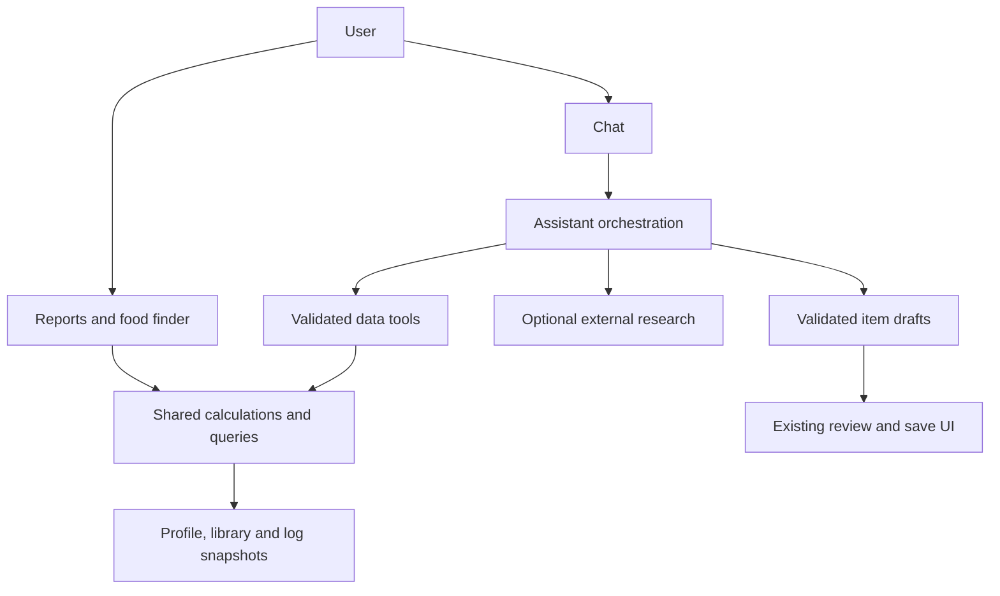

# Assistant and reporting architecture

Implemented September 8, 2026. The design below is now backed by the shared reporting services, assistant runtime, and application UI. The baseline audit is retained for context; its line references describe the old implementation.

## Implemented behavior

- **Personal chat:** targeted nutrition state, profile preferences and limits, paginated logs, complete frequency aggregation, ranked library portions, explicit favorites/exclusions, report links and staging cards. The assistant defaults ambiguous requests to library foods and offers outside-library ideas. A bounded conversation summary retains durable scope decisions; intake and goals are fetched afresh.
- **Reports without AI:** access **Reports** in the journal header, **Food finder** in the library, or **Nutrition reports** in chat. Presets cover high protein/low fat, protein per calorie, frequently eaten foods and nutrient contributors. Combine nutrient thresholds, local dates, favorites, sorting and grouping; compare recorded portions, current saved servings, per 100 kcal or known mass. Desktop tables and mobile cards support staging, favorites, CSV export, charts and asking chat about the exact report specification.
- **Selective evidence:** Auto/Off/On research in chat. Google grounding and OpenAI Responses research run separately from personal-data tools. Actual source URLs, Google claim links/search suggestions, and available provider usage are retained. Local Auto requests do not require a search; Off omits research; On forces a first research tool call and reports unavailable research explicitly.
- **Library custodian:** one schema registry for all six domains, item types, custom fields, reminders, nutrients and evidence. Text/image requests produce validated drafts; Composer can edit drafts and propose missing combo children. Unknown values remain distinguishable from zero and estimates. Library, batch, profile and log changes use persisted action cards with atomic application/status updates, stale-change checks and idempotent retries. Follow-up draft revisions supersede their predecessor when applied.
- **Shared data correctness:** journal/tray/chat use the same consumed-log rules and nutrition-state logic. Future/skipped entries do not count as eaten. Weight history converts kg/lb. New logs retain item identity/domain/evidence snapshots and combo provenance; history uses its saved macros. Date-only chat edits preserve recorded nutrition; quantity edits rescale it. Unknown calorie days do not create fictitious calorie-bank credit.
- **Bounded requests:** 24,000 characters of recent history, up to 24,000 characters of explicitly selected context, six model steps, twelve tool calls, one research request, 30,000 characters per result and 60,000 cumulative result characters. Repeated successful tool calls are reused within a turn. Domain schemas are fetched on demand. No complete diary/library snapshot is prepended to ordinary messages. Images live in a separate device IndexedDB store and only their references enter saved messages.

## Personal coach profile and check-ins (October 2026)

Chat fetches the saved profile at the start of every turn; the application also subscribes to profile changes. A small fresh context snapshot identifies missing or unconfirmed goals and the latest dated weight. `coachProfile` and `userPreferences` expose goals, allergies/intolerances, explicit food preferences, coaching philosophies, training, practical constraints and coaching style. These fields are editable in Profile → Your coach profile and are also included in coaching reports. Conversation summaries cannot override current saved facts.

An unconfirmed default maintenance goal and the adaptive engine's 175 lb placeholder are not personal facts. The coach is instructed to ask for goals and relevant weight/units before personalizing daily targets; weights at least 30 days old are flagged for confirmation. The recommendation tool refuses to use a fallback adaptive protein target unless sufficient facts exist or the user has an explicit protein target. Literal allergy/exclusion matches include combo components; this is not allergy certification or synonym recognition.

`profileSchema` documents writable fields. Profile proposals merge partial nutrient maps, preserve unrelated settings and consolidate changes within a turn into one review card. Arrays replace their field; an empty array clears it. Review cards display before/after values, and profile drafts support later revisions. Saved check-ins and profile changes commit atomically, retaining stale-data checks and idempotency. Keys, account permissions and device-local provider credentials are outside the assistant's tools.

`coachCheckIn` supplies six optional conversational topics and complete recent log counts by domain. The coach asks one or two questions at a time, accepts skips and reuses prior answers. `completeCheckIn` proposes the answered questionnaire, summary and any explicit profile changes together. The last 12 completed reviews are retained; `checkInHistory` pages through them. A review becomes complete only when its card is applied. Users can inspect and remove reviews in settings.

Check-ins default to seven days, adjustable from 1–90 days, with disable and “Tomorrow” controls. Due invitations appear when chat is opened; there is no background model invocation or push notification. Manual check-ins remain available when invitations are disabled.

`recordWeight` writes the standard body-weight journal item, ensuring targets and charts use the same measurement. `createLogEntry` supports all domains and expands combos with unit conversion, snapshots and provenance. `getLogs` supports domain, exact ID and custom-value searches; `updateLogEntry` supports schema-validated custom values, skipped status and calorie-bank exclusions, preserving untouched fields and historical nutrition. Journal creation commits the proposed entries and action status in one transaction and rejects changed library dependencies.

## Chat logging of estimated one-off meals

`logOneOffMeal` accepts a meal name, timezone-qualified date, the portion eaten, approximate nutrient totals and the assumptions behind them. It requires no existing library item, profile or library schema call. Natural reports of new intake, such as “I just had a waffle sandwich”, are treated as logging cues; unclear intent is clarified rather than assumed. Nutrients describe the whole portion eaten, stored as one serving. Every supplied nutrient is marked estimated; omitted nutrients remain unknown. Chat is instructed to ask only for material missing details and to offer reasonable assumptions for review when the user wants approximations.

A dedicated card shows the date, portion, approximate calories/macros and assumptions with a **Log meal** button. Applying it atomically creates the hidden one-off food record, journal entry and confirmed action status. The meal is excluded from regular library browsing and food suggestions, while remaining available for journal details, duplication and edits. Cancellation and failed transactions create neither record, and retries cannot log a meal twice. Journal rows label estimated nutrition.

For an unsaved correction, `pendingDrafts` and `reviseDraft` support updated portions, nutrient totals, dates and assumptions, using the same meal/log IDs. Applying the correction cancels its predecessor. A null nutrient patch restores unknown status. Existing log tools handle saved portion and date corrections, rescaling the historical estimate. Whole-portion arithmetic, unknown nutrient coverage, history inclusion, library exclusion, persistence failures, retries and review-card behavior are covered by tests. `resolveMeal` compares individual foods against visible saved food names and combo components before choosing the logging route. It returns bounded candidates, serving information and match coverage without staging or writing anything. When similar entries exist and the user has not chosen, both food logging routes return a clarification instead of creating a proposal. The coach asks whether to use the saved entries or a one-off estimate, then honors the user's choice. Explicit choices bypass a repeated route question; unmatched meals can proceed as estimates. These matching and choice paths are tested with direct tools and mocked model sessions. This flow permits estimates without external research; explicit verified restaurant/product lookups continue to use the research tool.

## Validation and operational limits

Automated tests cover reporting arithmetic, missing values, dates, weight/serving conversions, ranking/constraints, schema validation, native Gemini/OpenAI continuations, search routing, context limits, transaction failures, stale updates, retries and historical log edits. TypeScript and the production Vite build pass. Browser checks used synthetic records and exercised desktop/mobile report controls, ranking presets, staging, favorites, target modes and chat cards. No production records were changed.

Provider contracts are tested with mocks. Live model quality, quota/model-specific grounding support and real Firestore transactions still require a signed-in account and configured provider keys for release smoke testing; no live billable provider calls were made during this implementation. Unsupported research returns a visible error rather than silently claiming verified evidence. Vite retains its large-bundle warning.

Legacy logs with neither a surviving library item nor an item snapshot cannot be reliably assigned a domain; reports disclose them rather than inventing values. Legacy numeric zeros cannot retroactively be distinguished from missing label data. Historical profile versions do not exist, so historical targets use current settings evaluated at the requested date. Reports describe the locally synchronized scope, including offline cache limitations. Old image attachments remain readable, but new image bytes stay on the originating device; extracted draft fields and sources remain available in the synced conversation. Library membership is not pantry inventory, and food frequency is not an explicit favorite.

BetterTracking's assistant should retrieve the information needed for a request, explain it, and help the user act on it. The application should calculate nutrition totals, compare foods, and generate reports through shared deterministic services. Search should supply external evidence when needed. This makes personalization useful without sending an entire journal or library to a model.

## Product behavior

| User request | Data and computation | Assistant behavior | Web search |
|---|---|---|---|
| “What does the evidence say about protein timing?” | External evidence, no personal journal needed | Explain the evidence and attach citations to supported claims | Auto enables research for this kind of question |
| “Help me meet my protein goal” | Current intake, effective targets, dietary constraints, ranked library foods and portions | Suggest a few feasible options, show their impact, and offer to include foods outside the library | Usually unnecessary |
| “Suggest something new that I might like” | Compact consumption patterns, explicit likes/dislikes and dietary constraints | Recommend outside-library options; explain the observed preferences behind them | Use for product facts, nutrition verification, or evidence claims |
| “What foods do I eat most?” | Complete aggregation over the requested period | Explain counts, distinct days and nutrient contributions; link to the report | Unnecessary |
| “Show high-protein, low-fat entries” | Filter and rank a report in code | Open the same report available through the UI | Unnecessary |
| “Create this supplement from its label” | Relevant item schema, image extraction, unit conversion, validation | Present an editable draft with sources, unknowns and serving basis | Only if more external information is needed |
| “Change the serving size of my yogurt” | Fetch matching item, calculate proposed change, validate patch | Show the existing review card with an accurate before/after comparison | Unnecessary |

One conversation can combine these capabilities. Users should not have to choose between separate nutrition, library and reporting bots.

### Recommendation scope

- Default an ambiguous food recommendation to visible library foods, state that scope, provide useful suggestions immediately, and ask “Would you like ideas outside your library too?”
- Honor “only from my library” without repeatedly asking to broaden. Honor “something new” by looking outside the library immediately. Preserve the chosen scope through follow-ups such as “something quicker.”
- A saved library item is not proof that it is in the pantry. Avoid “you have this at home” unless the user supplies that information. Pantry inventory is a separate possible feature.
- Distinguish explicit favorites from frequently logged foods. Frequency is evidence of consumption, not proof of enjoyment. Sparse history should produce modest personalization with its date range stated.
- Return practical portions and their calories, protein, fat and carbs, with relevant limits and the resulting remaining amounts. Offer staging through existing item cards. If no option meets every constraint, explain the tradeoff rather than silently relaxing a limit.
- Explicit restrictions and exclusions take precedence over inferred preferences. Do not infer that an item meets an allergy restriction from an incomplete ingredient list.

Illustrative flow: “Help me meet my protein goal” → retrieve today's nutrition state and relevant profile → rank library portions in code → explain three options → offer outside-library suggestions. A follow-up accepting new ideas retrieves a small pattern summary and, when needed, public nutrition information. Neither step needs the complete journal in the prompt.

## Baseline audit (before implementation)

Before this implementation, the app already had streaming chat, image input, library/log tools, item cards and confirmation cards. It also has reusable serving calculations, an adaptive target engine, journal sorting/grouping, charts, and export.

The following findings are from code inspection, not live provider testing. Line numbers refer to the reviewed revision.

| Finding | Evidence | Consequence |
|---|---|---|
| Chat's snapshot includes only some calculated nutrition information, omits dietary preferences/full target details, and uses the viewed date | `components/GlobalChatAssistant.tsx:292` | Insufficient context for recommendations across all goals and limits; “today” can refer to another day |
| `queryLibrary` returns IDs and categorization without macros or serving sizes | `components/GlobalChatAssistant.tsx:618` | The assistant cannot compare returned foods nutritionally |
| `queryLogs` returns calories and the first 50 rows, without complete aggregates or pagination | `components/GlobalChatAssistant.tsx:635` | Frequency and macro answers cannot reliably cover the requested history |
| Snapshot includes a new timestamp, initial message includes all visible library names, and adapters replay all messages | `components/GlobalChatAssistant.tsx:759`, `services/geminiService.ts:245`, `services/aiModelService.ts:251` | The apparent differential context does not bound request size |
| Images are appended as base64 text and also supplied as image parts | `components/GlobalChatAssistant.tsx:774` | Duplicate input and expensive replay of image bytes as ordinary text |
| Tool handling has two rounds; second-round tool results are not interpreted by another model step | `components/GlobalChatAssistant.tsx:823` | Multi-step retrieval and authoring stop before completion |
| Tool outputs are embedded in a new user prompt; OpenAI call IDs are discarded | `components/GlobalChatAssistant.tsx:837`, `services/aiModelService.ts:327` | Provider tool state is not preserved correctly |
| Global chat has no search tool; adapters expose no citation metadata | `components/GlobalChatAssistant.tsx:377`, `services/geminiService.ts:282` | Grounded, attributable research is not implemented |
| Nutrition lookup requests search in its prompt without enabling the search tool and supplies a synthetic “AI Search Grounding” source; Architect accepts an unused search flag | `services/gemini/nutrition.ts:91`, `services/gemini/nutrition.ts:107`, `services/gemini/architect.ts:45` | A provider/source label can imply verification that did not occur |
| Creation accepts an unspecified object and defaults missing macros to zero | `components/GlobalChatAssistant.tsx:529`, `components/GlobalChatAssistant.tsx:726` | Missing evidence can become apparently valid nutrition data |
| Search grants popularity points even without a name match | `components/GlobalChatAssistant.tsx:360` | An unrelated popular item can be returned as a match |
| Calendar context and selected-log state are displayed, but `handleSend` does not attach their selected data | `components/GlobalChatAssistant.tsx:741` | The visible context controls do not deliver their implied context |

The local baseline passes: 26 tests across eight files and `npm run lint`. Those tests do not establish the correctness of chat orchestration, grounding, or the proposed reports.

## Shared data and reporting layer

Start with pure TypeScript functions over the data already subscribed in the app. An index by item ID and memoized aggregates will avoid repeated linear joins. No model calls are needed for these calculations. Suggested modules are `services/reporting/`, `services/recommendations/`, `services/assistant/`, and `services/librarySchema.ts`; these are proposed paths.

Use the existing `calculateLogMacros` and `calculateAdaptiveTargets` after fixing and testing their date, unit and eligibility inputs. Migrate Journal, tray, Reports and Chat to the same functions so displayed totals agree.

| Tool | Input | Bounded result |
|---|---|---|
| `getNutritionState` | Local date, timezone, as-of instant, optional staged selection | Consumed nutrients, burn, effective targets, remaining/overage, target origin, assumptions and coverage |
| `getUserPreferences` | Relevant field group | Dietary constraints, explicit likes/dislikes, recommendation scope and relevant coach context; never credentials |
| `queryFoodReport` | Source, range, comparison basis, nutrient filters, sort, cursor, limit | Ranked rows, complete aggregate summary, result count and report link/specification |
| `getConsumptionPatterns` | Date range, metric, limit | Top foods/categories/tags, occurrences, distinct days, last consumed, contribution and sparse-data indicators |
| `getRecommendationCandidates` | Nutrition state, scope, constraints, exclusions, limit | Feasible portions, nutrient contribution, projected state, ranking reasons and infeasible constraints |
| `getLibraryItems` / `queryLogs` | IDs or bounded filters, requested fields, cursor | Exact item details or raw entries only when needed for inspection/editing |
| `getLibrarySchema` | Domain and item type | Relevant schema, field descriptions, units and validation rules |
| `proposeLibraryChange` | Validated draft or allowlisted patch plus source references | Reviewable create/update action with validation findings |
| `researchNutrition` | Standalone public question or product query | Answer/evidence with genuine source references and retrieval status |

All data responses should expose their scope: range, timezone, as-of time, matching row count, returned count, missing-data count, completeness, and pagination where applicable. Compute aggregates over all matching eligible records before limiting rows. “Top 10” must mean the top ten in the requested range, not a ranking of a truncated sample.

### Data semantics to settle first

1. **Consumed versus planned:** Exclude skipped entries from actual intake. For “so far,” exclude entries after the as-of instant and uncommitted tray items. Preserve future entries as planned data. The current model does not fully encode completion; introduce explicit status if timestamp rules cannot distinguish scheduled items from consumed meals.
2. **Dates:** Use one local-calendar boundary helper and an explicit reference time. Keep actual today and viewed date separate. Normalize weight measurements before passing pounds to the target engine. Do not use future or skipped weight measurements.
3. **Historical truth:** Sum `LogEntry.calculatedMacros`; do not recalculate history using today's library macros. Add versioned domain/name/type metadata to new log snapshots. Backfill only what is recoverable; keep unresolved legacy entries visible as unknown coverage rather than assuming food or discarding them. Historical target comparisons require saved target/profile versions; otherwise label them as comparisons against current settings.
4. **Serving basis:** Library macros describe the entire `defaultServingSize`. Use that baseline for portion math. Only compare per 100 g when mass conversion is known; do not assume one ml equals one gram. Treat per serving and per logged entry as different report bases.
5. **Combos:** Sum stored logged entries once. Staging currently expands combos to children without parent meal identity (`hooks/useStaging.ts:55`). Add an optional group/source-combo ID for future meal-pattern reporting; do not infer historical combo frequency from child entries alone.
6. **Goals versus limits:** `customTargets` is currently a number map. Add explicit target semantics such as aim, minimum, maximum, or range. Preserve existing numbers without guessing the user's intended hard limits. Include target provenance: manual override, adaptive calculation, or fallback assumption. Keep `excludeFromBank` limited to bank calculations; it does not mean the food was not eaten.
7. **Unknown values:** Missing nutrient values are not zero. Add status/provenance alongside numeric values and show incomplete coverage. The legacy `salt` key is presented as sodium in mg; centralize that meaning and migrate explicitly if renamed. Do not silently equate salt mass with sodium mass.
8. **History versus candidates:** Hidden one-offs still contribute to intake/history; exclude them from visible-library suggestions by default. Group by stable item ID, not name. Introduce an explicit favorite flag separately from computed usage statistics.

The current Firestore subscription loads all logs (`services/firebase.ts:349`). Local aggregation saves model tokens but does not reduce those reads. As accounts grow, introduce bounded log queries and versioned aggregate documents with edit/delete invalidation. Report coverage must reflect what is available offline or partially loaded.

## Reports and food finder without AI

Expose a clear Reports entry from the Journal and a nutrient finder from the Library. Reuse one report specification so users can move between these surfaces and Chat without recreating filters.

Initial presets:

- High protein, low fat: protein minimum and fat maximum controls, with protein descending then fat ascending by default.
- Protein per 100 kcal: a density ranking with a minimum protein contribution option so trivial portions do not dominate.
- Most frequently eaten: switch between entry count, distinct days, and nutrient contribution.
- Biggest contributors: foods contributing the most protein, calories, fat, carbs, sugar, sodium or selected micronutrients over a period.

Offer source (logged entries or library foods), period, grouping, comparison basis, visible filter chips, sorting, serving details, and export. Use a responsive table or cards with expandable detail on mobile. Include empty and incomplete-data states. Zero-calorie records have an undefined protein-per-100-kcal ratio; avoid dividing by zero or inventing a ranking. Avoid a protein/fat ratio as the only definition of “best,” especially for zero-fat foods.

Opening, filtering, sorting and exporting these reports make no model calls. “Ask about these results” passes the report specification, coverage, and a small result summary. Chat-generated reports open the exact same controls. Library results can be staged through the existing tray.

## Recommendation computation

Build candidate generation in code: select eligible foods, apply explicit exclusions, enumerate practical servings, calculate their nutrients, and score goal progress and tradeoffs. Rank hard-constraint feasibility before softer preferences such as recency or variety. Do not infer numeric ceilings where the profile only supplies a general target.

Start with individual foods and existing combos; later add a bounded search over small combinations if needed. Avoid having a model invent amounts and then perform all nutrition arithmetic itself. The assistant selects among computed options and explains why they suit this request. Recalculate the projection when a portion changes or the user stages it.

For new foods, provide a small preference summary, not raw logs, to generate ideas. Verify exact packaged-product nutrition from the user's label or a relevant product source. Label generic-food estimates as estimates. Keep external suggestions distinct until the user chooses to create a library draft.

## Context and orchestration

Keep persistent conversation storage separate from the model request. Store user-visible text, structured attachment references, sources, tool/action records, and compact conversation state. Provide a legacy reader that strips old context blocks and base64 markers when preparing model history, while keeping past messages viewable.

A request starts with concise behavior instructions, current local date/timezone, viewed date, active selection references, search preference, a bounded recent conversation, and unresolved follow-up context. Retrieve personal nutrition data for personal requests and domain schemas for authoring requests. Store selection references structurally; fetch selected dates/log IDs with explicit bounds when used.

Keep temporary data snapshots outside user messages and replace obsolete snapshots. Never replay image bytes as text. Store images outside chat message text, send relevant image parts once, and retain extracted fields plus source references for follow-ups; re-read an image only when its detail is needed.

Use a small, stable tool catalog rather than a second LLM classification request on every turn. Deterministic UI choices route directly; the conversation model can select relevant data/research/schema tools. Fetch verbose domain instructions only for the domain being edited. Add semantic retrieval only if ordinary structured filters and small text searches prove insufficient; numerical nutrition queries do not need a vector database.

Replace the two-round block with a provider-neutral loop that preserves native calls, call IDs, results and required provider state. Continue until there is a final answer, a pending user action, an error, cancellation, or a resource limit. Parallelize independent reads; order dependent calls and mutations. Render typed cards from validated action results, without depending on the model to reproduce executable JSON markers.

Treat retrieved pages, library descriptions, log notes and image text as data, not authority to invoke actions or change assistant behavior. Tool arguments and action permissions must be validated in application code even when the model returns syntactically valid JSON.

Initial limits to evaluate, not performance claims: 10–20 recommendation/report rows per response, paginated raw log retrieval, a maximum of six model steps and twelve application tool calls per turn, and an explicit text-context budget based on the selected model. Compact older conversation only at a threshold; retain decisions, active drafts and source/report IDs. Re-fetch mutable nutrition facts rather than trusting an old summary. Do not summarize on every message.

Record actual provider input/output usage when available, model steps, tool calls, searches, latency, cache hits and errors. Label local character estimates as estimates. Cache deterministic reports by input revisions and invalidate after log/profile/library changes. Provider-managed state or prompt caching does not itself guarantee smaller billed context.

Handle streaming cleanup in `finally`, offer cancellation, prevent duplicate sends, and surface actionable failures. Retrying a read is safe; replaying a write needs a durable action ID. Persist action status and revalidate pending edits against current items. A failed save must remain failed in the UI; current confirmation handling catches save errors and can still mark the card confirmed.

## Search and sources

Use an unobtrusive **Auto / Off / On** setting, defaulting to Auto. Auto can invoke research for evidence questions, uncertain external facts, or product lookups; personal totals, history reports and library-only comparisons normally use local data. Off omits external research capability. On requires a research attempt for the response and a clear failure state if unavailable. An explicit per-message request to search should update or override the visible setting for that turn.

Provide the research adapter with only the public question and necessary generic constraints. Personal diary details, identity and exact consumption history do not belong in public search queries. Prefer separate research calls for mixed personal/public requests so query scope is controlled. This is an application function, not a requirement for a second conversational persona.

Preserve claim-to-source links and distinguish source types: user's log/report, library nutrition, uploaded label, external evidence, or estimate. A provider name is not a source. Show clickable citations next to supported claims and a short source list; a report citation opens its range/filters. Grounding supplies evidence to assess, not a guarantee that every claim is correct. If research fails, do not fabricate links or imply verification.

Gemini's Generate Content grounding response supplies `groundingMetadata`, including source chunks and claim supports; the documentation also specifies Search Suggestions rendering. The adapter must retain this metadata instead of yielding only text and function calls. [Google grounding documentation](https://ai.google.dev/gemini-api/docs/generate-content/google-search)

Google's current tool-combination guide describes model-specific preview support and preserved tool IDs/signatures; its current JavaScript example requires an SDK newer than 2.0.0. This repository declares `@google/genai` `^1.33.0`. Treat native combined-tool support as a tested adapter upgrade, with a separate grounded research call as the initial compatible design. Do not simply add `googleSearch` to the old loop. [Google tool-combination documentation](https://ai.google.dev/gemini-api/docs/tool-combination)

OpenAI's Responses API supports the built-in web search tool and citation annotations. The current application uses Chat Completions with custom functions, so add a Responses research adapter or migrate deliberately; the current adapter does not gain search automatically. Preserve native function call/result relationships for any migrated path. [OpenAI web search documentation](https://developers.openai.com/api/docs/guides/tools-web-search), [OpenAI function calling documentation](https://developers.openai.com/api/docs/guides/function-calling)

Select behavior from verified provider/model capabilities. Do not silently fall back from a grounded request to an ungrounded model while claiming sources were checked. Include a capability/contract test before changing the installed SDK or enabling native mixed tools.

## Library authoring from text and images

Create one runtime schema/validation registry shared by Composer, Chat, image extraction and import. TypeScript types alone do not validate model output. Cover all six domains and distinguish `INGREDIENT` from `COMBO`; domain-specific schema lookup should explain allowed fields, units, required values and examples.

The schema must cover identity, description, ingredients, category/tags, base unit, serving amount, macro/micro units, custom fields, children and quantities, exercise routine details, visibility, and structured reminders where relevant. Domain definitions should describe the fields that matter to that domain rather than require invented nutrition for measurements or notes.

Use this pipeline: extract observed information → normalize known units and serving basis → validate → resolve material missing/conflicting details → show an editable draft → save through the existing review flow. Preserve source references and distinguish label-observed, user-supplied, externally sourced, and estimated fields. Do not fill an unreadable micronutrient with zero or overwrite a user correction with a generic lookup.

For labels, preserve whether values are per serving, per 100 g/ml, or per container. Do not convert a bar to grams unless its mass is known. Validate finite nonnegative amounts where appropriate, required serving size, supported units, schema keys/options and references. Check combo cycles/missing children and calculate totals in code. Derive IDs/ownership in application code; restrict edits to supported fields and merge only validated changes.

For custodial work, reuse report/search primitives to find likely duplicates, incomplete serving data and inconsistent units. Present precise proposed changes with before/after details. Record applied, failed and stale actions so reloading a conversation cannot apply the same batch again.

## Implementation sequence and completion checks

| Phase | Deliverable | Completion check |
|---|---|---|
| 1. Correct data foundation | Shared eligibility/date/weight helpers, nutrition state, report queries, frequency summaries; accurate source labels | Journal/tray/chat calculations agree on fixtures; no synthetic verified-source claims |
| 2. Reports and personalized food suggestions | Reports UI and presets, library nutrient finder, candidate/portion ranking, compact chat data tools | Reports work without AI; protein-goal request uses computed portions and honors recommendation scope |
| 3. Conversation infrastructure | Structured transcript/attachments/actions, bounded native tool loop, context budget, selection wiring, usage tracking | Multi-step requests complete; old images/snapshots are not replayed as text; save failures and retries remain accurate |
| 4. Selective research | Auto/Off/On control, provider research adapters, citations and source persistence | Under Auto/Off, local-only requests make zero searches; On performs the requested research attempt; grounded claims have usable evidence links; unavailable research is explicit |
| 5. Unified library authoring | Shared runtime schemas and validators, image evidence/drafts, durable review actions | Text/label creation across domains uses consistent units and preserves missing values; edits survive retries safely |

Phases can overlap where interfaces are stable. Do not release enhanced chat recommendations without the shared calculation checks, or new search/authoring tools without the orchestration and validation they require. Start with the complete nutrition-state → ranked-library-portions → staging workflow and its matching non-AI report.

Regression scenarios should cover local midnight/DST, today versus viewed date, skipped/future entries, kg/lb weights, changed/deleted library items, missing historical metadata, hidden one-offs, duplicate names, combos, zero denominators, incompatible units, unknown nutrients, custom goal semantics and target overrides. Provider tests should cover streamed call fragments, call IDs, native tool continuation, search annotations, partial failures, cancellation and action deduplication.

End-to-end evaluation prompts should include every product behavior in the first table, follow-up requests that change scope/date, missing profile/history, unreadable label servings, unsupported research models, and a personal request after a long photo conversation. Assert data/tool behavior and arithmetic, not exact assistant prose. Use provider-mocked tests by default; run a small explicit live-provider evaluation before release and measure real token/search/latency costs.

## Product photos and library drafts

Chat uses the selected model's multimodal text recognition. The shared provider repeats Gemini's complete generation config on **every** send: the SDK replaces, rather than merges, per-message config. Supplying function-calling mode without the declarations caused the repeated HTTP 400. Tool-free requests omit both tool declarations and function-calling config. A regression test uses the real SDK with intercepted HTTP to check both initial and tool-response requests.

Photos are decoded before attachment and normalized to JPEG. The crop UI renders in a body portal so transformed/clipped chat panels cannot trap it. It starts with the entire photo, uses normalized pointer coordinates, supports corner dragging, movement, rotation, keyboard sliders and a whole-photo bypass, and exports original pixels at up to 2560 pixels on the longest side. It never exports the preview, crop border or mask. Users can select up to four photos, review each in sequence, skip a photo, edit a thumbnail, or use the camera capture input. Image load and size errors are shown without silently dropping the rest of the queue.

Library Draft Assistant forces `recordLabelEvidence` on a turn with new photos. Other chat surfaces offer the same tool for product labels. The model reports identity, manufacturer, description, ingredients, supplement actives, five section-completeness statuses, serving basis, and nutrient rows with the printed evidence. The parser accepts only supported nutrients and units from facts panels with a consistent basis and an actual printed amount. Marketing, %DV alone, inequalities, conflicting columns, salt mass masquerading as sodium, and unknown serving bases do not become nutrition amounts. Unknown nutrients keep their evidence status; changing serving basis invalidates retained amounts unless replaced explicitly. This validation catches inconsistent structured output but cannot guarantee the model transcribed a photo correctly; users still review and save the draft.

Drafts may be nameless or incomplete while collecting information; final saves retain strict item validation. Manufacturer, supplement facts and label-review metadata survive draft updates, imports and saves. Visible partial ingredients remain partial, and the thread explicitly asks for missing details via another photo or typed text. Complementary photos retain earlier readable fields; manual or verified manufacturer-source corrections can resolve missing sections. The assistant can search exact manufacturer/product variants using the existing research tool and must distinguish web evidence from photographed values. It must ask when identity or variants conflict.

Photo-only turns stay in bounded model history. Up to four images total (current photos plus recent prior attachments) enter a request. Global-chat bytes stay in device IndexedDB, separate from Firestore message metadata; unavailable or older photos have an explicit history notice. Composer photos and retries remain in memory for that draft. Failed Composer turns retain photos and input for retry. Clearing a draft conversation clears its image history.

Validation includes provider wire configuration, partial/complete labels, marketing versus facts panels, units and serving columns, supplement actives, manual follow-ups, history budgets, unknown nutrition and source preservation. Browser checks cover portal visibility, original-resolution cropping, rotation, multi-photo queues, recropping, cancellation and removal at desktop and phone viewport sizes. Live recognition accuracy still needs representative real packaging photos with a configured vision-capable model.

Composer uses its own library-authoring instructions instead of the global coach/logging workflow. A described restaurant meal or recipe can produce a rounded estimate for the stated portion without requiring package panels or an exact restaurant search. Exact restaurant verification requires enough identity information, such as a location or official URL. Counted portions use count units (two slices = 2 pcs, with a readable serving caption); all stored nutrients describe that whole serving. Recipe assumptions stay distinguishable from confirmed ingredients and unknown nutrients remain unknown.

`labelReview.kind` distinguishes photographed labels from descriptions; missing kind on existing records retains label behavior. Description reviews show assumptions without claiming text was partly read or requiring missing package sections. The exposed field schema specifies the bounded notes array. Validators normalize a scalar note to a one-element array and null notes to an empty array; malformed objects or oversized notes receive an actionable format error. Notes-only draft patches preserve other review sections, and changing a serving basis clears its stale caption unless a replacement is provided. Unsupported optional organization suggestions do not block valid core draft data.

The Composer runtime returns only the final response text, so internal tool-repair narration does not accumulate in the saved conversation. It reports unresolved tool errors at completion and clears a tool's error after a successful retry. Only reads are cached; a repeated draft update after intervening changes must execute again. Restaurant regression coverage exercises the supplied Giuseppe's request through the real runtime, editor, validation and save flow with a simulated provider, including string notes, failed corrections, recovery, unknown nutrients and one-slice versus whole-serving scaling. These checks validate application behavior; they do not certify a live model's nutrition estimates.
